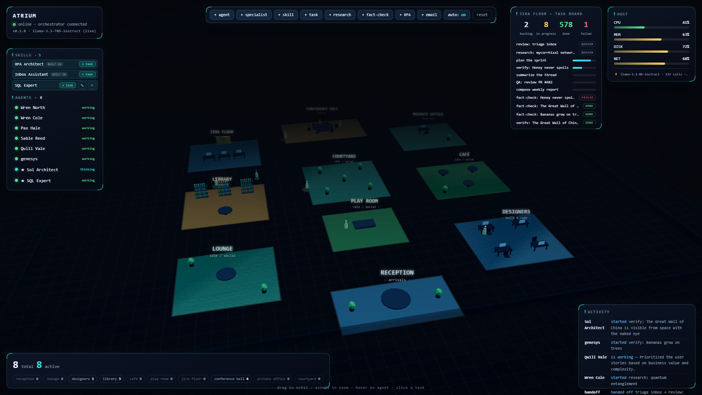

<div align="center">
  

# Atrium

**A living 3D office for your agents — watch them work, and orchestrate them.**


</div>

A self-hostable **agent visualizer + orchestrator**: agents move through a 3D
office, do real work (live Wikipedia research, a two-agent fact-check pipeline,
UiPath/RPA solution designs, your own custom-skill tasks), hand off to each
other, fail and retry honestly — and you watch and steer all of it. Built with
**Three.js + Vite** (dashboard) and a tiny **Node + WebSocket** backend
(orchestrator). Plain ESM JavaScript, no frameworks.

> Originally inspired by the [hermesagora.com](https://www.hermesagora.com/)
> concept; now its own project. Not affiliated with Hermes or Nous Research.

New to agent orchestration? Read the guide —
**[docs/ORCHESTRATION.md](docs/ORCHESTRATION.md)** — or see it in pictures:
**[docs/DIAGRAMS.md](docs/DIAGRAMS.md)** (10 diagrams: the loop, the agent state
machine, skills, dispatch, handoffs, failure paths).

---

## Quick start

### Option A — dashboard only (simulation, zero backend)

```bash
npm install
npm run dev
```

Open the printed URL (default <http://127.0.0.1:5173>). The orchestration loop
runs **in the browser** — a fleet of agents picks up tasks and works them, and
all the controls work immediately. Great for playing with the ideas.

### Option B — dashboard + real orchestrator (recommended)

```bash
npm install
cp .env.example .env      # optional: add one API key for a live model (below)
npm run dev:all
```

Then open the dashboard pointed at the orchestrator:

```
http://127.0.0.1:5173/?feed=ws://127.0.0.1:8787
```

Now the fleet, task board, and host metrics are real, state lives server-side
(and **survives restarts** — `server/state.json`), and your commands go over
the wire. Without a key the backend still runs; agents do simulated work.

---

## What you can do

**Watch (monitoring)**
- Ten office zones around a courtyard; agents walk to the right zone for their
  task and animate by state. **Working agents glow and emit radar pings** — when
  the shared rate limiter chokes, the pings stop. The scene is the load monitor.
- HUD: status, per-zone occupancy, host meters, **live LLM telemetry** (the
  *active* post-rotation model + calls / throttled / errors), the task board
  (backlog / in-progress / done / **failed**), and an activity feed.

**Drive (orchestration)**
- **Toolbar**: `+ agent`, `+ specialist`, `+ skill`, `+ task`, `+ research`,
  `+ fact-check`, `+ RPA`, `+ email`, `auto: on/off`, `reset`. Create buttons
  prompt for input — your typed topic/claim/brief flows into the real pipeline.
- **SKILLS panel**: every capability in the office — built-in and custom — each
  with one-click **+ task**, and ✎ edit / ✕ delete for the ones you authored.
- **Agent directory**: click a row (or the 3D avatar — they stay in sync) for
  pause/resume, rename, remove, assign-a-specific-task, send-to-zone. Skill
  chips + ★ mark specialists.
- **Task board**: click any task for its detail panel — result (📚 summary /
  ⚖️ verdict / 🏗️ design), step history, handoff lineage, and the saved
  deliverable path.

## Skills — capabilities + routing

A **skill** gates who may take a task: the dispatcher (and manual assign) only
give skill-gated work to an agent that owns the skill. If nobody does, a
specialist **auto-spawns on demand**.

| Skill | Kind | What it does |
|---|---|---|
| `rpa-architect` (built-in) | `rpa-design` | senior UiPath solution architect: ANALYZE the process → DESIGN the automation (REFramework, queues, selectors, risks, estimate) |
| `email` (built-in) | `email` | reads your Outlook inbox, triages, and writes a reply **draft** via Microsoft Graph — never sends ([setup](server/email.js)) |
| **yours** (custom) | `custom` | click **`+ skill`**, type a name + the expertise. That prompt *is* the skill — a specialist spawns and matching tasks route only to it. No code, no restart. |

Specialist results aren't lost in the feed — they're saved as Markdown
**deliverables** in `server/outputs/` and linked from the task detail panel.

## Fault tolerance (visible, honest)

Real-work steps that hit hard errors don't fake success. The resilience stack,
every layer observable in the HUD:

**30s network timeout → model rotation → limiter backoff → step retry →
50s watchdog (hung calls can't wedge an agent) → requeue once → dead-letter as
FAILED** (red badge on the board).

Deterministic tests cover the policy: `npm test` (no network, stubbed
executors — retry→FAILED, the watchdog, skill-gated assign, delete-skill
cancellation).

## Real model executor (the whole fleet on a live LLM)

Wired in [`server/executor.js`](server/executor.js), enabled automatically when
a key is present. `LLM_PROVIDER` in `.env` picks the key + base URL — all
OpenAI-compatible:

| Provider | Key | Notes |
|---|---|---|
| `nvidia` | `NVIDIA_API_KEY` | generous free tier — **recommended** |
| `openrouter` | `OPENROUTER_API_KEY` | free `:free` slugs; shared capacity, often throttled |
| `groq` | `GROQ_API_KEY` | fast |
| `ollama` | any non-empty string | local GPU, no limits (`http://localhost:11434/v1`, e.g. `hermes3:8b` on a 24GB card) |

How it stays within free limits:

- **Shared rate limiter** across the whole fleet (`LLM_RPM`) — agents that
  can't get a slot wait and retry; you can watch the bottleneck live.
- **Model fallback list** — `LLM_MODEL` is comma-separated; on 429 / 5xx /
  timeout the executor rotates to the next model.
- **WIP cap** (`MAX_CONCURRENT`) — only N tasks run at once, so a few visibly
  finish instead of the whole fleet starving.
- Non-blocking: a slow model call never stalls the tick loop.

### Real research tasks (genuine tool use)

Click **`+ research`**: the agent **searches** the live Wikipedia API,
**reads** the real article, then **summarizes that real content** with the
model — 📚 done means a grounded summary exists, not a counter. This is the
template for any real tool. Code: [`server/research.js`](server/research.js).

### Real fact-check pipeline (multi-agent, on real data)

Click **`+ fact-check`**: **Agent A** judges a claim against the **full
article text** (⚖️ SUPPORTED / CONTRADICTED / UNCLEAR), a **handoff** carries
the verdict to a **different agent**, and **Agent B** pulls an independent
second source (DuckDuckGo, Wikipedia fallback) and ✅ CONFIRMs or ❌ DISPUTEs
it. B never saw A's source — genuine independent verification.

## How it works (the short version)

```
  browser  ──────  COMMANDS (spawn, define_skill, assign…)  ──────▶  orchestrator
  browser  ◀─────  EVENTS   (snapshot, tick: agents+tasks+llm)  ───  orchestrator
```

The **orchestrator** is the single source of truth; the dashboard never mutates
state. Each ~1.1s tick: **intake → dispatch (skill-aware scheduler) → advance
every agent's state machine → publish**. The long version with exercises is
[docs/ORCHESTRATION.md](docs/ORCHESTRATION.md); the pictures are
[docs/DIAGRAMS.md](docs/DIAGRAMS.md); the wire format is
[docs/PROTOCOL.md](docs/PROTOCOL.md).

## Project layout

```
index.html               # mount points + boot veil
src/                     # the dashboard (Three.js + DOM HUD)
  main.js                # wires gateway <-> world + HUD + controls
  sim/gateway.js         # data + command layer (MockGateway, RemoteGateway)
  scene/                 # world.js (renderer/lights), office.js (zones), agent.js (avatars)
  ui/                    # hud.js (telemetry + board), controls.js (commands + skills panel)
server/                  # the orchestrator (Node + ws)
  index.js               # WebSocket edge: snapshots, ticks, command intake
  orchestrator.js        # fleet + board + skill-aware dispatcher + retry policy
  agent-runtime.js       # agent lifecycle state machine + watchdog + executor seam
  executor.js            # LLM executor: rate limiter, fallback rotation, timeouts
  research.js            # research + fact-check + verify steps (real tools)
  rpa.js                 # the RPA/UiPath solution-architect skill
  custom-skill.js        # runs skills you author on the page
  email.js               # Outlook read + draft-only replies (Microsoft Graph)
  artifacts.js           # saves specialist results to server/outputs/*.md
  store.js / metrics.js  # persistence + real host CPU/MEM/DISK
  protocol.js            # the shared contract (imported by BOTH sides)
docs/                    # ORCHESTRATION.md · DIAGRAMS.md (+ PNGs) · PROTOCOL.md
test/                    # deterministic orchestration tests (node --test)
```

## Configuration

| What | Where |
|---|---|
| Provider / key / models / rate | `.env`: `LLM_PROVIDER`, `*_API_KEY`, `LLM_MODEL` (fallback list), `LLM_RPM` |
| WIP limit | env `MAX_CONCURRENT` (default 6) |
| Orchestrator port / tick rate | env `PORT`, `HOST`, `TICK_MS` |
| Initial fleet size | env `FLEET` (default 5) |
| Scheduler policy | `_dispatch()` in `server/orchestrator.js` |
| Zones / furniture / camera | `src/scene/office.js`, `src/scene/world.js` |

## Scripts

| Command | Does |
|---|---|
| `npm run dev` | dashboard only (in-browser simulation) |
| `npm run server` | orchestrator only (ws://127.0.0.1:8787) |
| `npm run dev:all` | both together |
| `npm test` | deterministic orchestration tests (no network) |
| `npm run build` / `preview` | production bundle / serve it |
| `npm run diagrams` | re-render docs/DIAGRAMS.md Mermaid → PNGs |
| `npm run email:login` | one-time Microsoft sign-in for the email skill |
