# Atrium — How It Works (Diagrams)

Visual companion to [ORCHESTRATION.md](ORCHESTRATION.md) and
[PROTOCOL.md](PROTOCOL.md). Every diagram points at the file that implements it.
Diagrams are [Mermaid](https://mermaid.js.org/) — they render on GitHub and in
most Markdown viewers.

> 🖼️ **Image exports:** every diagram below is also rendered to PNG in
> [`docs/diagrams/`](diagrams/) (e.g. `01-system-architecture.png`) — handy for
> slides, issues, or any viewer that doesn't render Mermaid. After editing any
> Mermaid source below, regenerate the images with **`npm run diagrams`**
> (renders every block via mermaid-cli; see [`diagrams/export.mjs`](diagrams/export.mjs)).

Jump to: [System](#1-system-architecture) ·
[The loop](#2-the-orchestration-loop-one-tick) ·
[Agent](#3-an-agent-is-a-state-machine) ·
[Protocol](#4-one-click-end-to-end-commands--events) ·
[Skills model](#5-what-a-skill-is) ·
[Dispatch](#6-skill-based-dispatch-the-scheduler) ·
[RPA skill](#7-the-rpa-architect-skill-real-2-phase-work) ·
[Custom skills](#8-design-a-skill-on-the-page-custom-prompt-skills) ·
[Handoff](#9-multi-agent-handoff-fact-check--verify) ·
[Deliverables](#10-deliverables-results-become-files)

---

## 1. System architecture

The browser is a **passive mirror**: it sends commands and renders whatever the
orchestrator publishes. The orchestrator is the **single source of truth**. One
WebSocket carries both directions. The shared `protocol.js` is imported by both
sides so message shapes can't drift.

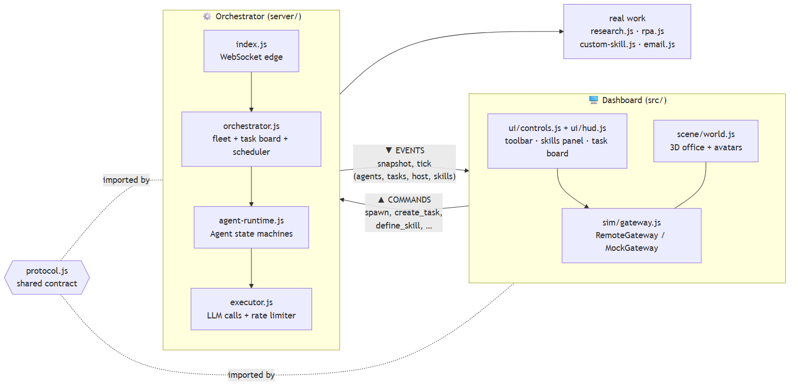

Mermaid source (edit here, then re-export — see top of file)

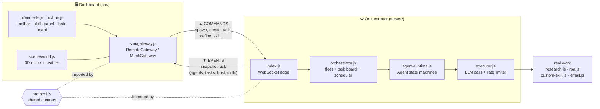

---

## 2. The orchestration loop (one tick)

This four-step loop *is* the whole idea — the same shape every orchestrator uses
(k8s, CI runners, actor supervisors). It runs every `TICK_MS` (~1.1s) in
[`Orchestrator.tick()`](../server/orchestrator.js).

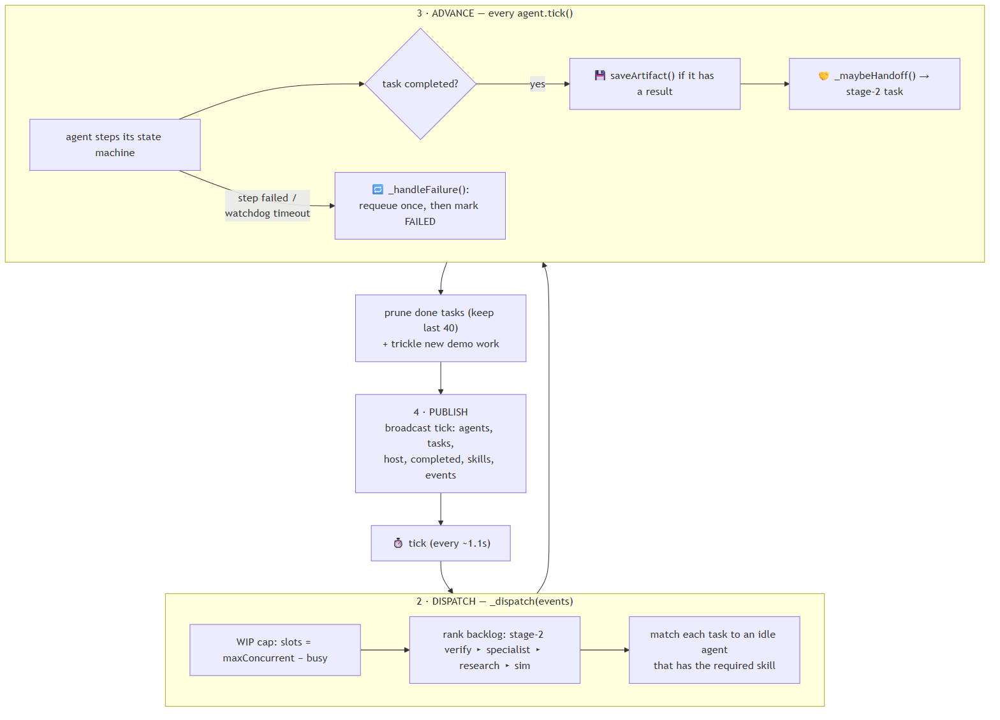

Mermaid source (edit here, then re-export — see top of file)

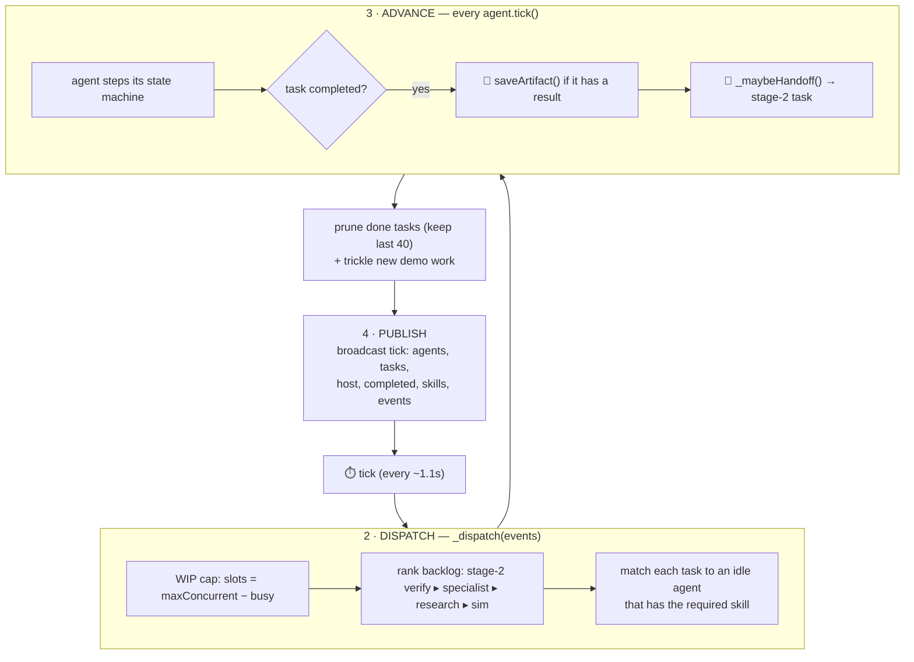

---

## 3. An agent is a state machine

Each agent is one worker with a lifecycle ([`agent-runtime.js`](../server/agent-runtime.js)).
The key design point is the **WORKING** state: a real model call takes seconds,
so the agent **fires the call once and stays put** while it's in flight, applying
the result on a later tick — the tick loop never blocks.

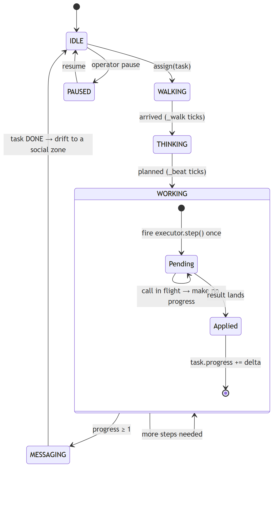

Mermaid source (edit here, then re-export — see top of file)

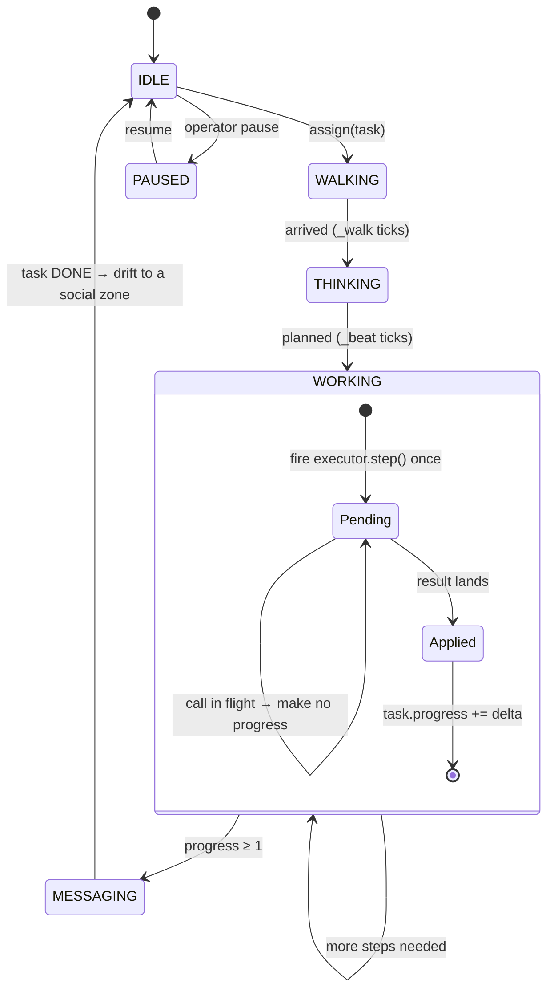

> The `executor.step(agent, task)` call is **the seam for real work**. Swap what
> it does and nothing else in the machine changes. See diagram 7.

---

## 4. One click, end-to-end (commands & events)

Declare intent, then observe reconciled state. The browser never mutates
anything directly — it sends a command, gets an `ack`, and sees the change in the
next `tick`. ([PROTOCOL.md](PROTOCOL.md))

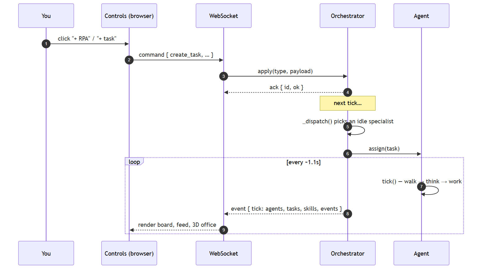

Mermaid source (edit here, then re-export — see top of file)

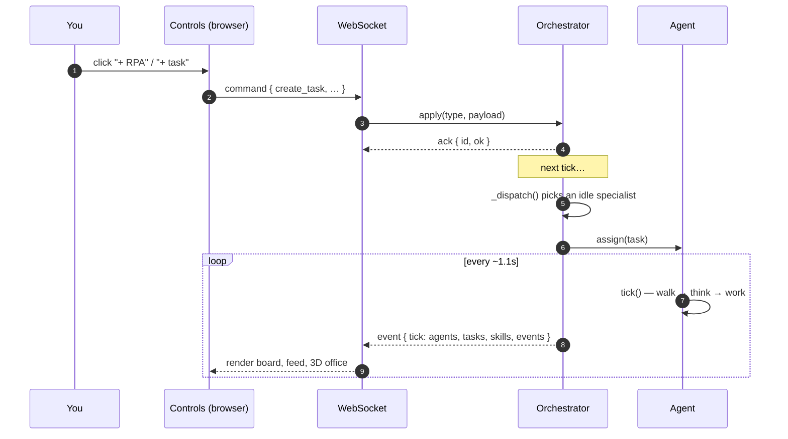

---

## 5. What a *skill* is

A **skill = a capability + routing**. The capability is a task `kind` with a real
`step()`; the routing is `requiredSkill(task)` gating *which* agent may take it.
Two flavors:

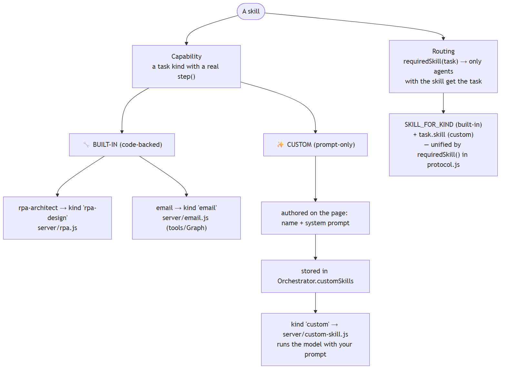

Mermaid source (edit here, then re-export — see top of file)

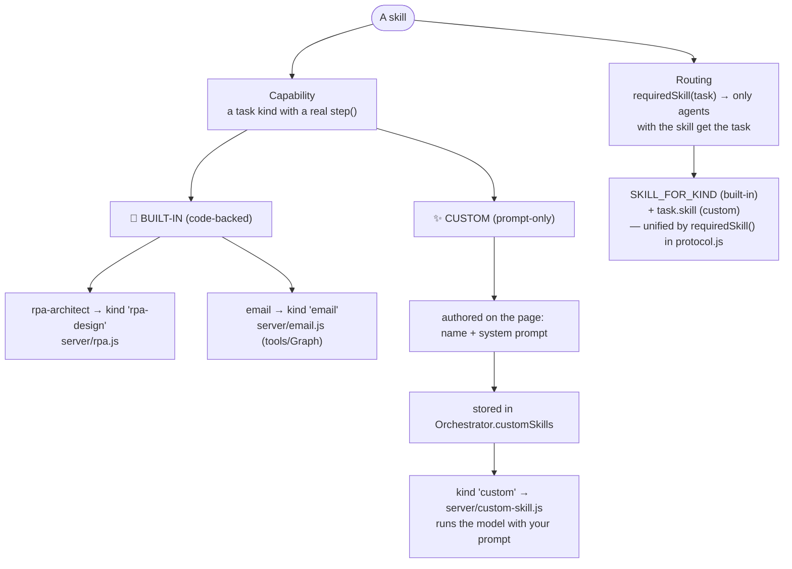

> Built-in skills need code because they **touch tools** (RPA reasoning, the
> Microsoft Graph API). Custom skills are pure expertise — *just a system
> prompt* — so they can be designed live in the browser.

---

## 6. Skill-based dispatch (the scheduler)

`_dispatch()` is where scheduling policy lives. A skill-gated task only goes to a
capable agent; if none exists, a specialist is **auto-spawned on demand**.

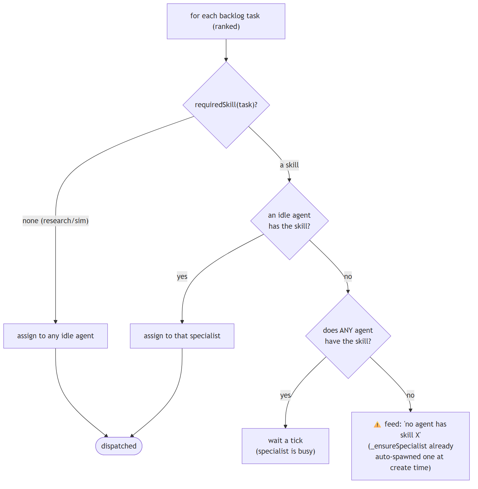

Mermaid source (edit here, then re-export — see top of file)

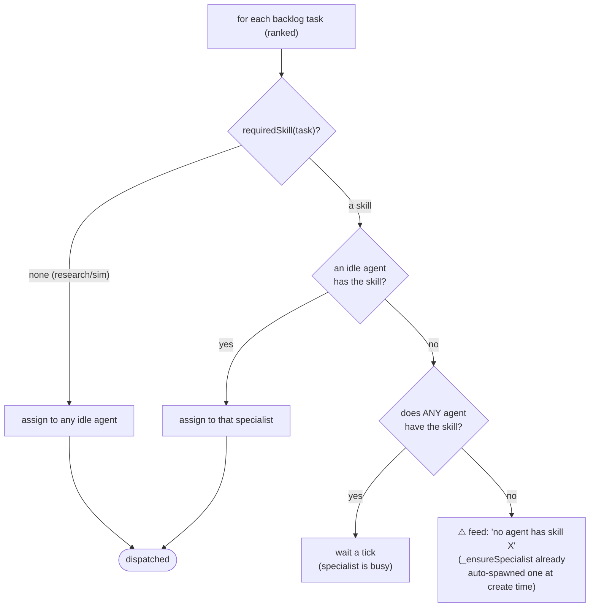

> WIP cap: the loop stops once `maxConcurrent` tasks are in flight, so under a
> rate-limited model a few tasks visibly progress while the rest idle.

---

## 7. The RPA Architect skill (real, 2-phase work)

Skill `rpa-architect`, task kind `rpa-design`
([`server/rpa.js`](../server/rpa.js)). A pure-expertise skill: the value is the
senior-architect **system prompt**. It runs in two real model calls over two
ticks, then the design is saved as a file.

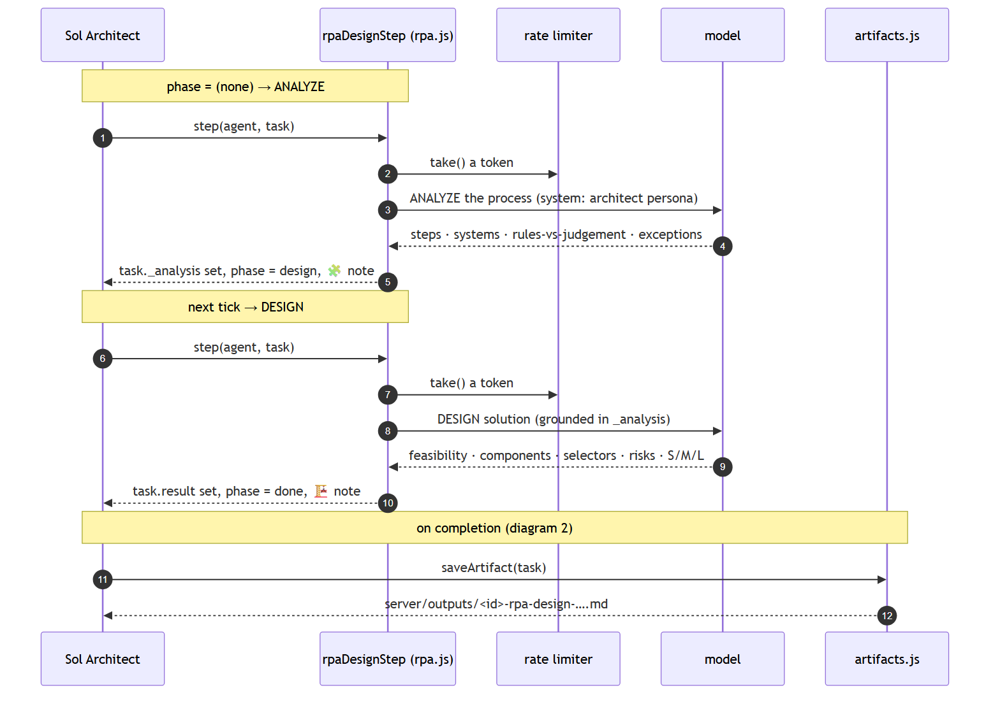

Mermaid source (edit here, then re-export — see top of file)

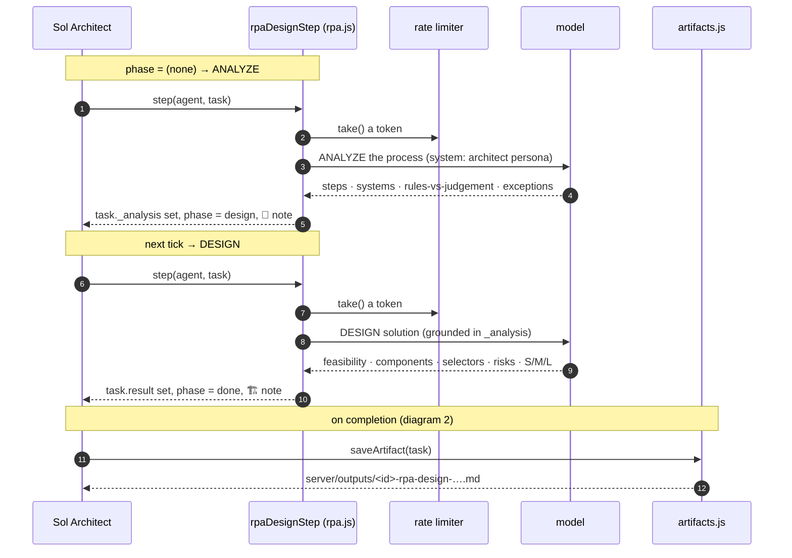

---

## 8. Design a skill on the page (custom prompt-skills)

The `+ skill` button turns "a name + an expertise prompt" into a working
specialist — no code, no restart. ([`server/custom-skill.js`](../server/custom-skill.js))

Mermaid source (edit here, then re-export — see top of file)

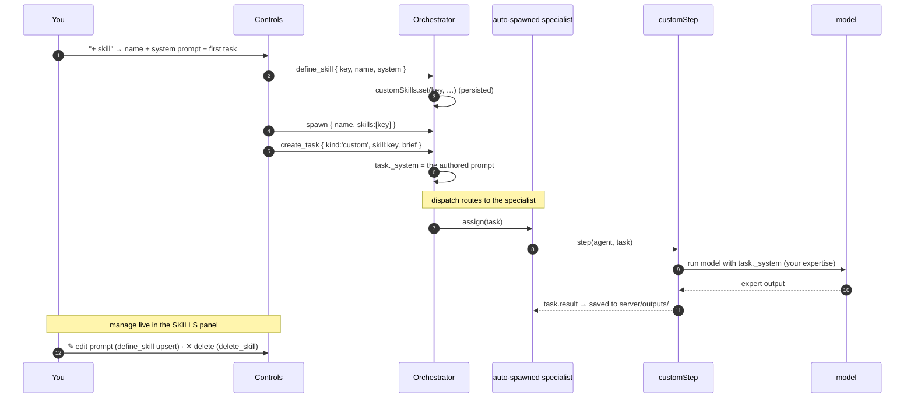

---

## 9. Multi-agent handoff (fact-check → verify)

Real collaboration on real data: agent A reaches a verdict, then a **different**
agent B independently verifies it against a second source.
([`server/research.js`](../server/research.js), `_maybeHandoff` in orchestrator)

Mermaid source (edit here, then re-export — see top of file)

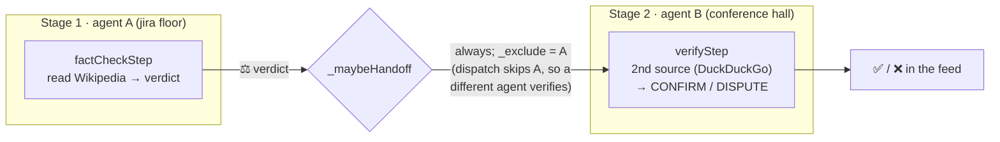

> Skill-gated specialist work (rpa-design, email, custom) does **not** get a
> generic narrated handoff — it stands on its own.

---

## 10. Deliverables — results become files

Real work should leave something you can keep. When a **specialist** task
completes with a `task.result`, it's written to a Markdown file *before* the task
is pruned. The ambient research/fact-check churn is **not** filed (it would flood
the folder). ([`server/artifacts.js`](../server/artifacts.js))

Mermaid source (edit here, then re-export — see top of file)

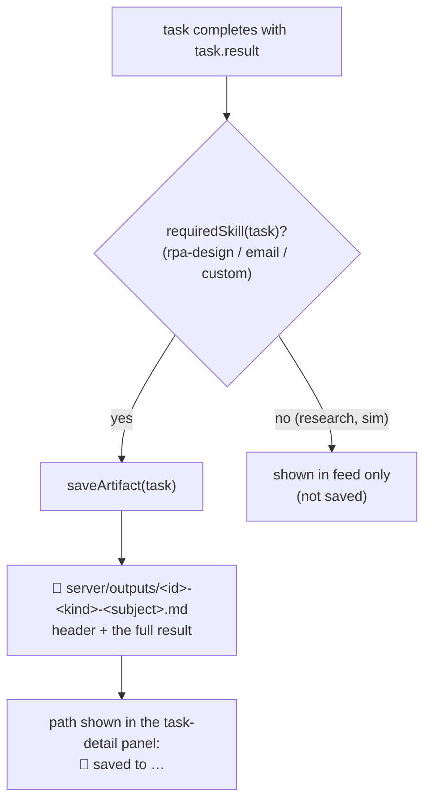

---

### Where each diagram lives in code

| Diagram | Primary files |
|---|---|
| System architecture | `server/index.js`, `src/main.js`, `server/protocol.js` |
| The loop | `server/orchestrator.js` → `tick()`, `_dispatch()` |
| Agent state machine | `server/agent-runtime.js` → `Agent.tick()` |
| Commands & events | `server/protocol.js`, `src/sim/gateway.js` |
| What a skill is | `server/protocol.js` (`SKILLS`, `SKILL_FOR_KIND`, `requiredSkill`) |
| Dispatch | `server/orchestrator.js` → `_dispatch()`, `_ensureSpecialist()` |
| RPA skill | `server/rpa.js`, `server/executor.js` |
| Custom skills | `server/custom-skill.js`, `Orchestrator.defineSkill()` |
| Handoff | `server/research.js`, `Orchestrator._maybeHandoff()` |
| Deliverables | `server/artifacts.js` |
